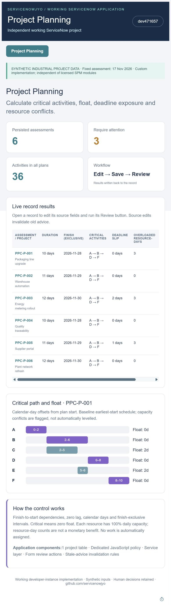

# Project Planning

A complete working custom ServiceNow project with editable source records, a server-side JavaScript policy, a Review form button, persisted advice, stale-advice invalidation and a live workspace. This project installs independently; neither of the other two projects is required.

Which activities drive completion, where is float available, and where do resources conflict?

## The real-world problem

Weekly planning meetings tend to ask three questions: *Are we going to hit the date? Which tasks actually matter for that date? Is anyone double-booked?* In many teams the answers come from a Gantt chart someone updates by hand, so a one-day slip on a critical task, or an engineer booked on two tasks at once, is noticed only when the deadline is already at risk.

This app runs a critical-path calculation on each plan and answers all three questions on one record: the finish date and how many days it slips past the deadline, which tasks are critical (zero float) and which have slack, which tasks are ready to start now, and every day a person is over-allocated.

**Who uses it:** project planner (maintains tasks and dependencies), project manager (acts on slip and conflicts), resource manager (resolves over-allocation).

### Decision guide

| Signal | What it means | Typical next step |
|---|---|---|
| `deadline_slip_days` > 0 | The critical path finishes after the deadline (the deadline is the last allowed working day) | Shorten a critical task, add resources, overlap work, or renegotiate the date |
| `critical_task_ids` | Tasks with zero float: any delay moves the finish date | Protect these first; watch them daily |
| `float_days` > 0 | Slack a task can absorb | Use it to level resources without moving the finish |
| `ready_task_ids` | Predecessors done, not yet started | Start or assign these now |
| `overloaded_resource_days` > 0 | A person is booked over 100% on those days | Move a non-critical task within its float, or reassign |

Example: in PPC-P-001 (packaging line), the Engineer is booked 200% for three days because *Configure platform* (critical) and *Prepare integrations* (2 days float) overlap. The plan meets its 27 November deadline on paper, but only if the Engineer can do two jobs at once. Using the 2 days of float only cuts the overlap to 2 days; running the tasks one after the other pushes the finish 2 days past the deadline. That is the real decision for the manager: add a second engineer for three days, or accept a later date.

## Observed results — synthetic data

- 6 synthetic plans contain 36 activities. Two plans finish after their deadline (PPC-P-003 by 2 days, PPC-P-005 by 1 day); three have resource conflicts.
- 17/17 local policy tests passed.
- **Deadline fix (17 Nov 2026):** an off-by-one reported plans finishing *on* their deadline day as 1 day late. The deadline is now treated as the last allowed working day; the fix was redeployed and re-verified live (see `evidence/05-deadline-fix-redeploy.txt`). Screenshots were retaken after the fix.
- 6/6 persisted ServiceNow results matched the local expected results.
- The two installed Script Includes matched the packaged source exactly.
- Source edit → old-advice invalidation → recalculation → fixture restoration → repeat review passed on the instance.
- The real form Review button was clicked and its success message captured.

Assessment: 17 November 2026. Instance timestamps are retained as displayed by ServiceNow; they may use a different clock/time zone. Verification is implementation evidence on synthetic cases, not measured business improvement.

After installing on your own developer instance, open `https://<your-instance>.service-now.com/u_project_planning.do`.



## What it does

Earliest/latest starts and finishes, total float, critical activities, finish date, deadline slip, ready activities and overloaded resource-days.

PPC-P-001 starts 2026-11-18, lasts 10 calendar days and finishes at the exclusive boundary 2026-11-28, so it meets its 2026-11-27 deadline with 0 days slip. Its critical activities are A, B, D and F. C and E have two days of float. Engineer is allocated 200% on three baseline resource-days.

Finish-to-start dependencies only, zero lag, calendar days, positive integer durations and finish-exclusive intervals. Capacity is 100% per named resource per plan. Plans are independent resource pools; this does not perform cross-project resource levelling. Completion flags determine readiness, but the CPM dates describe the full baseline network, not remaining-duration forecasting. The activity network is edited as JSON on the planning record and is also supplied as a 36-row CSV.

## Run locally

Requires Node.js 18 or newer. No external packages, API keys or installation required.

```sh
npm test
npm run build
```

The tests execute `servicenow/ProjectPlanningPolicy.js`, the same file installed in ServiceNow. The builder regenerates expected results, source hashes, the UI Page XML and standalone installers from local files. Original CSVs and JSON data are supplied.

## ServiceNow hands-on

Read [the step-by-step guide](docs/STEP_BY_STEP.md). The working application uses Global custom table `u_ppc_planning`, Script Includes `ProjectPlanningPolicy` and `ProjectPlanningService`, one Review UI Action, one before-insert/update Business Rule and UI Page `u_project_planning`.

The instance did not have native `pm_project`, `pm_project_task`, `cost_plan` or `resource_plan` tables. This is a custom implementation, not a claim that licensed ServiceNow SPM modules were activated. Current workflow is administrator-only; production role design, security testing, change control and operational hardening are outside this completed developer-instance implementation.

## Files

- `data/`: deterministic, invented industrial-project records; no real company or personal finances.
- `servicenow/`: policy, service, button, rule, workspace and install/verify scripts.
- `tests/`: hand-calculated cases, thresholds and invalid-input checks.
- `results/`: expected records, source hashes and actual local TAP test log.
- `evidence/`: real browser observations and three real screenshots from the separate project.
- `docs/`: instructions, dataset provenance, architecture, sources and validation limits.
- `media/`: LinkedIn infographic, alt text and caption draft.
- `PROMPT.md`: reproducible project prompt, incorporating the separate-project requirement.

Published by [servicenowjyo](https://github.com/servicenowjyo).
